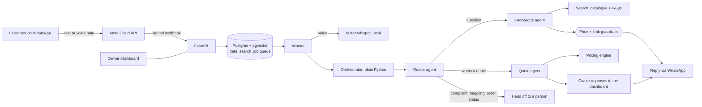

# Munim

An open-source WhatsApp sales assistant for small Indian businesses, starting with printing presses
and photographers. A customer messages the shop's WhatsApp number in English, Hindi, Gujarati or
Hinglish, by text or voice note. Munim answers from the shop's own catalogue and FAQs, collects what
the customer needs, prepares a GST-correct quotation for the owner to approve, sends it as a PDF,
and keeps track of every lead. A person can take over any chat at any time.

It runs on free tiers or locally: FastAPI, Postgres with pgvector (also the job queue, no Redis), a
React dashboard, a local embedding model, local speech-to-text (faster-whisper), and any
OpenAI-compatible language model (Groq, Gemini, OpenRouter or a local Ollama).

**Status:** built and tested end to end against fakes, and checked against a real language model on a
sample. **Not yet run with a real WhatsApp number or real customers**: the pilot has not happened, so
no claim here is a field result. See [Honest limits](#honest-limits).

## The rule that matters most

**The language model never calculates, invents or edits a price.** Prices come from the catalogue and
a pricing engine in integer paise (`backend/app/pricing/`, 100% branch coverage, property-tested).
Every message to a customer passes a guardrail that finds every rupee amount in it, however it is
written, and blocks the message unless the amount was returned by a tool in that turn. A quotation
reaches a customer only after the owner approves it.

## How it fits together



Four agents (Router, Knowledge, Quote, Responder) with fixed tool lists; which one runs next is decided
by ordinary Python, not by a model. Lead scoring, hand-off and follow-ups are deterministic code.

## Numbers you can reproduce

| What | Result | How to reproduce | What it proves |
|---|---|---|---|
| Wrong prices, stranger's contact or payment details, and prompt leaks that got past the guardrails | **0 of 1,384** price attacks, **0 of 316** contact and payment attacks (a stranger's phone, UPI ID, link, email or bank account), **0 of 263** leak attempts; 0 of 65 honest replies blocked | `make adversarial` | The guardrail, not a model. Attacks are replies a misbehaving model might send (ignore-your-rules, `₹` after the number, "two hundred rupees", "do sau rupaye", "pay the advance to x@ybl", zero-width characters...). The first price run found 23 of 35 disguises got through and the contact run found two holes; both readers were fixed. A translated copy of the system prompt is not caught |
| MunimBench, scripted model | 279 items, **100% price accuracy, 0 hallucinated amounts**, 100% hand-off, 100% groundedness | `make eval` | The system around the model (retrieval, price rendering, guardrails, routing). Says nothing about model quality |
| Retrieval with real multilingual embeddings | right FAQ or product found for 94.7% of 247 questions (English 98%, Hindi 96%, Hinglish 94%, Gujarati 93%, Gujlish 91%) | `make eval EMB=local` | Search quality, per language |
| Real models, same evenly spread **sample of 40 of the 367 items** (one run each, free tiers) | see the three rows below | `EVAL_USE_REAL_LLM=1 make eval LLM=real EMB=local` with your own keys | First signals, not a leaderboard |
| ... Groq `gpt-oss-20b` / `gpt-oss-120b` | price accuracy 95%, **0 hallucinated amounts**, groundedness 91%, hand-off 95% (before the route and model-error metrics existed) | | |
| ... Gemini `3.5-flash-lite` / `3.5-flash` alone | 13 of 40 items had a failed model call (free-tier 429s and timeouts). On the **27 items where every call succeeded**: route 100%, intent 96%, hand-off 100%, groundedness 100%, retrieval 100%, price accuracy 100%, **0 hallucinated amounts** | | |
| ... Gemini first, Groq as fallback | 1 failed call in 40 (the fallback works); price accuracy 14 of 16 priced items, **0 hallucinated amounts**, route 100%. One miss was traced to the router dropping "A5" from "A5 brochure"; the prompt was fixed and checked on six phrasings, not re-benchmarked | | |
| A prompt change that breaks pricing | caught by the replay gate in CI | `make replay` | A deliberately broken prompt fails the build |

Cost and speed: the report exists (`make cost`) but **no real numbers are published yet**. Free tiers are the weak point: Gemini and Groq both rate-limited this benchmark, which is why the fallback chain matters.

MunimBench is its own open dataset: 367 enquiries in five languages
([datasheet](benchmark/DATASHEET.md), CC BY 4.0). Its Hindi, Gujarati and romanised wording was drafted
by an AI and still needs a native speaker's review.

## Run it

Needs Docker, and `uv` and `pnpm` for development.

```bash
cp .env.example .env     # defaults work with no keys at all
make dev                 # api, worker, postgres, dashboard on 127.0.0.1
make seed                # two demo businesses; prints their logins once
make test                # backend and dashboard tests (fakes only, no network)
make lint
```

With no model key the assistant hands every chat to a person: the app works, the AI does not. Add a
free-tier key (see `.env.example`) to switch it on. To run it for a real business, with backups and a
Cloudflare Tunnel, follow **[docs/SELF_HOST.md](docs/SELF_HOST.md)**. Owners: **[docs/OWNER_GUIDE.md](docs/OWNER_GUIDE.md)**.

## Safety and privacy

- Every query is scoped to one business, through repositories that take a tenant context, and isolation
  tests cover the resources that hold customer data.
- WhatsApp credentials are encrypted at rest; webhooks are verified by signature and are idempotent.
- Rate limits on login, registration, the webhook and each business; one chat cannot use up the model quota.
- Customer text is treated as untrusted data and never placed in a prompt's instruction section.
- Owners can export or permanently erase a customer's data. A [privacy notice template](docs/PRIVACY.md)
  is included (not legal advice).

## Honest limits

- **No pilot yet.** The plan is two to three real businesses for two weeks; until then nothing here is a
  field result.
- **No real WhatsApp number or real voice note has been tried.** The WhatsApp side is tested against a
  fake Meta, and Whisper against a fake model.
- **Free-tier models rate-limit hard.** The client waits out short limits and falls back to the next
  provider, but a free tier will slow a busy shop.
- Messages outside WhatsApp's 24-hour window cannot be sent (message templates are not built), so follow-ups
  are drafts the owner copies.
- Audio benchmark clips, multi-turn quote scenarios and a multi-model leaderboard are not done yet.

Decisions and their reasons are in [DECISIONS.md](DECISIONS.md); where we are is in
[PROGRESS.md](PROGRESS.md); the full plan is [BUILD_PLAN.md](BUILD_PLAN.md).

## Licence

Code: [MIT](LICENSE). Benchmark items and datasheet: CC BY 4.0.
